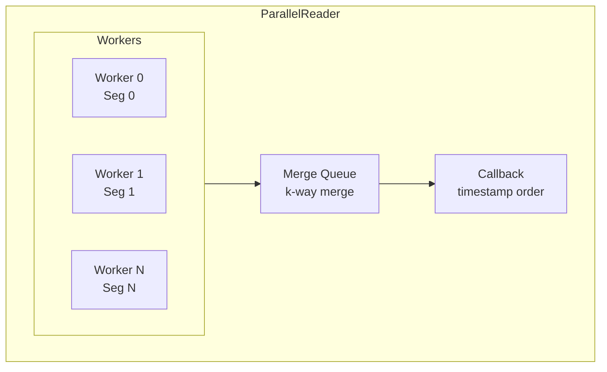

# ParallelReader

`ParallelReader` processes multiple segments concurrently using a thread pool, merging results into timestamp-sorted order for delivery.

```cpp
struct ParallelReaderConfig
{
  std::filesystem::path data_dir;
  uint32_t num_threads{0};            // 0 = auto-detect
  size_t prefetch_segments{2};
  size_t event_buffer_size{10000};
  std::optional<int64_t> from_ns;
  std::optional<int64_t> to_ns;
  std::set<uint32_t> symbols;
  bool verify_crc{true};
  bool sort_output{true};
};

class ParallelReader
{
public:
  explicit ParallelReader(ParallelReaderConfig config);

  using EventCallback = std::function<bool(const ReplayEvent&)>;
  uint64_t forEach(EventCallback callback);

  using BatchCallback = std::function<bool(const std::vector<ReplayEvent>&)>;
  uint64_t forEachBatch(BatchCallback callback);

  template <typename Result>
  using SegmentProcessor = std::function<Result(const std::vector<ReplayEvent>&,
                                                  const SegmentInfo&)>;

  template <typename Result>
  std::vector<Result> mapSegments(SegmentProcessor<Result> processor);

  ParallelReaderStats stats() const;
  const std::vector<SegmentInfo>& segments() const;
  uint32_t numThreads() const;
};
```

## Purpose

* Maximize throughput by reading multiple segments in parallel.
* Merge events from different segments into correct timestamp order.
* Enable map-reduce style processing over segments.

## Configuration

| Field             | Type                 | Description                           |
|-------------------|----------------------|---------------------------------------|
| data_dir          | `filesystem::path`   | Directory containing segments         |
| num_threads       | `uint32_t`           | Thread count (0 = hardware threads)   |
| prefetch_segments | `size_t`             | Segments to prefetch ahead            |
| event_buffer_size | `size_t`             | Events per segment buffer             |
| from_ns           | `optional<int64_t>`  | Start timestamp filter                |
| to_ns             | `optional<int64_t>`  | End timestamp filter                  |
| symbols           | `set<uint32_t>`      | Symbol IDs to include                 |
| verify_crc        | `bool`               | Verify CRC32 checksums                |
| sort_output       | `bool`               | Merge to timestamp order              |

## Statistics

```cpp
struct ParallelReaderStats
{
  uint64_t segments_processed;
  uint64_t events_read;
  uint64_t trades_read;
  uint64_t book_updates_read;
  uint64_t bytes_read;
  uint64_t crc_errors;
  uint64_t unknown_frames_skipped;
  int64_t start_time_ns;
  int64_t end_time_ns;

  double eventsPerSecond() const;
  double throughputMBps() const;
};
```

`bytes_read`, `crc_errors` and `unknown_frames_skipped` have the definitions
of the `ReaderStats` fields of the same names: segment-file bytes consumed as
event data, without segment headers or indexes; frames skipped for a CRC
mismatch; frames of a record type this build does not know. Every path counts
all of the fields above, `segments_processed`, `events_read`, `trades_read`
and `book_updates_read` included: one thread, sorted and unsorted output, and
`forEachBatch`. The counters accumulate across calls on the same reader. On
the multi-threaded paths a segment's events are counted once it has been read,
whether or not the callback stopped before taking all of them.

## Usage

### Basic Iteration

```cpp
replay::ParallelReaderConfig config{
    .data_dir = "/data/market",
    .num_threads = 4
};

replay::ParallelReader reader(config);

reader.forEach([](const replay::ReplayEvent& event) {
    // Events arrive in timestamp order
    return true;
});

auto stats = reader.stats();
std::cout << "Throughput: " << stats.eventsPerSecond() << " events/sec\n";
```

### Batch Processing

```cpp
reader.forEachBatch([](const std::vector<replay::ReplayEvent>& batch) {
    // Process entire segment at once
    return true;
});
```

### Map-Reduce Pattern

```cpp
struct SegmentStats {
    uint64_t trades;
    uint64_t books;
    double volume;
};

auto results = reader.mapSegments<SegmentStats>(
    [](const std::vector<replay::ReplayEvent>& events, const replay::SegmentInfo& info) {
        SegmentStats stats{};
        for (const auto& e : events) {
            if (e.type == replay::EventType::Trade) {
                stats.trades++;
                stats.volume += e.trade.qty_raw / 1e8;  // quantity scale is 1e8
            } else {
                stats.books++;
            }
        }
        return stats;
    });
```

## Convenience Functions

```cpp
// Simple parallel iteration
uint64_t count = replay::parallelForEach("/data/market", callback, 4);

// Parallel event count
uint64_t total = replay::parallelCount("/data/market");
```

## Architecture



## Ordering

`segments()` lists the segments in `BinaryLogReader::segmentsInReadOrder()` order: by proven first event where a segment proves one, by file name otherwise (see [BinaryLogReader, Ordering guarantee](binary_log_reader.md#ordering-guarantee)). What `forEach` delivers depends on the path it takes:

* **One thread, or at most two segments.** `forEach` is `BinaryLogReader::forEach`, with that page's ordering guarantee: `Sorted` segments in timestamp order across segments, overlapping ones merged, a segment without the `Sorted` flag sorted in its file-name position. One segment at a time is in memory.
* **Several threads and more than two segments, `sort_output = true`.** Every segment is read into memory, a segment without the `Sorted` flag is sorted, and all of them are merged: the whole tape arrives in timestamp order, equal timestamps by file name, then by position in the segment.
* **`sort_output = false`.** Each segment's events in its stored order, segments in whatever order the workers finish; no ordering promise.

`forEachBatch` and `mapSegments` hand each segment's events over in stored order. With `from_ns` set, a `Sorted` segment is entered at its last index entry strictly below `from_ns`.

## Notes

* Workers read segments independently and buffer events in memory.
* Thread count defaults to `std::thread::hardware_concurrency()`.
* Best for bulk processing where I/O bandwidth is the bottleneck.
